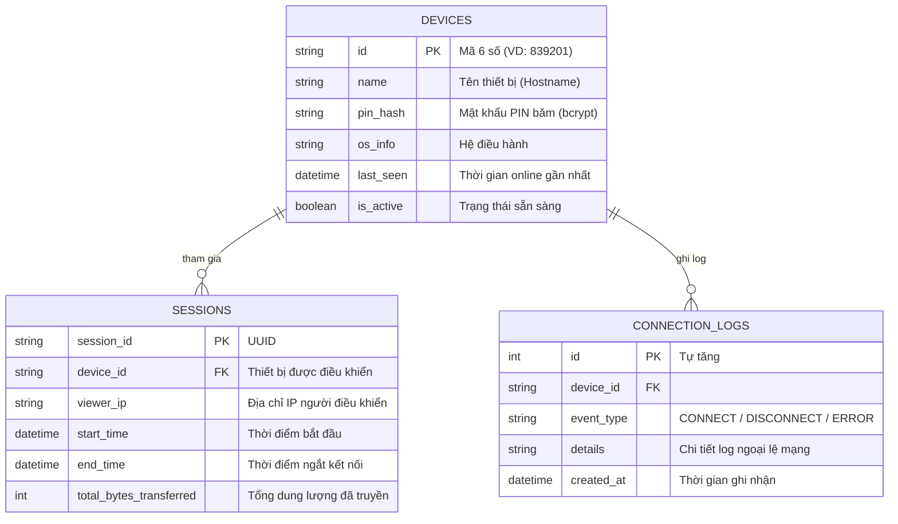
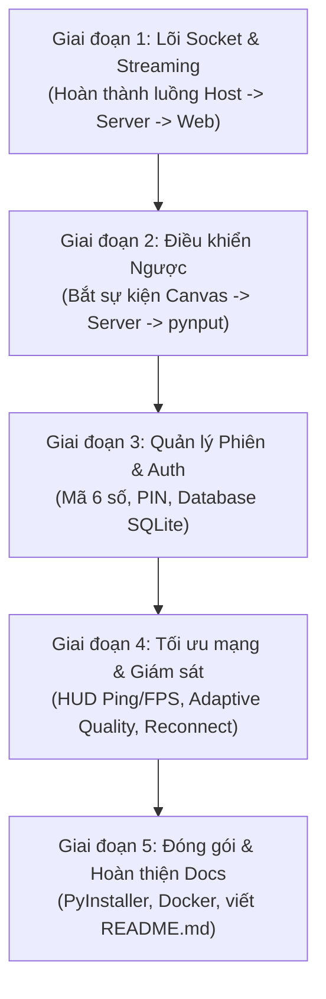

# TÀI LIỆU ĐẶC TẢ DỰ ÁN BÀI TẬP LỚN LẬP TRÌNH MẠNG (PTIT)

## 📌 TÊN ĐỀ TÀI: WEB-BASED REMOTE DESKTOP SYSTEM (MINI ANYDESK)
> **Môn học:** Lập trình mạng — Học viện Công nghệ Bưu chính Viễn thông (PTIT)  
> **Giảng viên phụ trách:** TS. Đặng Ngọc Hùng — Khoa CNTT 1  
> **Kiến trúc:** Client – Server – Host Agent (Hybrid Web & Desktop Architecture)

---

## 1. TỔNG QUAN DỰ ÁN

### 1.1. Đặt vấn đề
Các phần mềm điều khiển máy tính từ xa như TeamViewer, AnyDesk, UltraViewer đòi hỏi cả hai bên (người điều khiển và người bị điều khiển) đều phải cài đặt phần mềm chuyên dụng. Đồ án này xây dựng một giải pháp **Remote Desktop gọn nhẹ dựa trên nền tảng Web**:
- **Người điều khiển (Viewer):** Không cần cài đặt bất kỳ phần mềm nào, chỉ cần truy cập vào trình duyệt web (React Web App) trên máy tính/điện thoại/máy tính bảng là có thể xem và điều khiển chuột, bàn phím máy từ xa.
- **Máy bị điều khiển (Host):** Chạy một phần mềm tác nhân cực nhẹ (Host Agent viết bằng Python), không cần quyền can thiệp hệ thống sâu, giao tiếp với máy chủ trung gian qua Socket.
- **Máy chủ chuyển tiếp (Relay Server):** Xử lý xác thực, cấp phát mã phiên (Session ID), điều phối và chuyển tiếp các luồng dữ liệu nhị phân (Binary Frames) thời gian thực bằng FastAPI WebSocket.

### 1.2. Mục tiêu kỹ thuật môn Lập trình Mạng
- Vận dụng mô hình truyền thông **Full-Duplex TCP** thông qua giao thức **WebSocket** (RFC 6455).
- Tự thiết kế và hiện thực hoá **Giao thức tầng Ứng dụng (Application-Level Protocol)** để đóng gói và phân định luồng hình ảnh (Binary Frame) và sự kiện điều khiển (JSON Control Packet).
- Giải quyết bài toán **băng thông mạng, điều tiết FPS, trễ (latency)** và xử lý **ngắt kết nối bất thường (Fault Tolerance)**.

---

## 2. KIẾN TRÚC HỆ THỐNG (SYSTEM ARCHITECTURE)

Hệ thống gồm 3 thành phần độc lập giao tiếp qua mạng:

```
+--------------------------+                      +-----------------------------+
|    💻 HOST AGENT         |                      |     🌐 WEB VIEWER           |
| (Python Desktop Client)  |                      | (React + HTML5 Canvas)      |
|                          |                      |                             |
| - Screen Capture (mss)   |                      | - Canvas Render             |
| - JPEG Compression       |                      | - Mouse/Key Event Capture   |
| - Input Control (pynput) |                      | - Latency & FPS Monitor     |
+------------+-------------+                      +--------------+--------------+
             |                                                   |
    WebSocket Binary Stream                             WebSocket Binary Stream
      (Upload Frames)                                    (Download Frames)
    & JSON Event Stream                                 & JSON Event Stream
             |                                                   |
             +--------------------> [ ⚙️ FASTAPI ] <---------------+
                                     RELAY SERVER
                                 - Session & Room Manager
                                 - Binary Packet Forwarder
                                 - SQLite / Peewee / SQLAlchemy
```

1. **Host Agent (`source/client/agent`):**
   - Đóng vai trò là Socket Client kết nối đến Server.
   - Định kỳ chụp khung hình desktop (dùng `mss`), nén ảnh thành buffer JPEG (`Pillow`), gửi binary bytes qua WebSocket.
   - Lắng nghe luồng lệnh điều khiển từ Server, dịch tọa độ và kích hoạt sự kiện phần cứng thật bằng `pynput` hoặc `pyautogui`.
2. **Central Relay Server (`source/server`):**
   - Xây dựng trên nền **FastAPI (Asynchronous ASGI)**.
   - Quản lý phiên kết nối: Ghép cặp giữa Host Agent và Web Viewer thông qua **6-digit Device ID** và **PIN/Passcode**.
   - Chuyển tiếp (Relay) gói tin với độ trễ tối thiểu (In-memory forwarding, Non-blocking I/O).
3. **Web Viewer Client (`source/client/web`):**
   - Xây dựng bằng **React + Vite + TailwindCSS**.
   - Kết nối WebSocket tới Server với chế độ `binaryType = "blob"`.
   - Giải mã luồng byte JPEG và render trực tiếp lên thẻ `<canvas>`.
   - Bắt các sự kiện chuột (`mousemove`, `mousedown`, `mouseup`, `wheel`) và bàn phím (`keydown`, `keyup`), chuẩn hóa tỉ lệ màn hình và gửi ngược về Server.

---

## 3. CÔNG NGHỆ VÀ THƯ VIỆN SỬ DỤNG

| Thành phần | Công nghệ / Thư viện | Vai trò kỹ thuật |
| :--- | :--- | :--- |
| **Server** | Python 3.10+, **FastAPI**, Uvicorn | Web framework bất đồng bộ, quản lý WebSocket endpoints |
| | Pydantic | Xác thực dữ liệu và định nghĩa schema gói tin |
| | SQLite + SQLAlchemy (hoặc Tortoise-ORM) | Lưu trữ thông tin thiết bị, lịch sử phiên kết nối |
| **Host Agent** | Python 3.10+, **websockets** | Client giao tiếp WebSocket bất đồng bộ (`asyncio`) |
| | `mss` | Thư viện chụp màn hình đa nền tảng tốc độ cao (~60+ FPS) |
| | `Pillow` (PIL) | Xử lý resize ảnh và nén byte stream sang chuẩn JPEG |
| | `pynput` | Can thiệp điều khiển chuột và bàn phím ở tầng OS |
| | `PyInstaller` | Đóng gói mã nguồn Agent thành file thực thi duy nhất (`.exe` / binary) |
| **Web Viewer** | **React (Vite)**, TypeScript / JavaScript | Single Page Application (SPA), render giao diện |
| | HTML5 Canvas API | Vẽ trực tiếp các frame ảnh nhận từ luồng nhị phân |
| | Lucide React, TailwindCSS | Thiết kế UI trực quan, hiện đại, hiển thị HUD |
| **Triển khai** | Docker, Docker Compose | Đóng gói Server và Web Client để chạy nhanh trên mọi môi trường |

---

## 4. ĐẶC TẢ GIAO THỨC TRUYỀN THÔNG (COMMUNICATION PROTOCOL)

Hệ thống sử dụng mô hình kết hợp: **HTTP/REST** cho các thao tác khởi tạo phiên và **WebSocket** cho truyền dữ liệu thời gian thực.

### 4.1. Giao thức HTTP REST (Session & Auth)

| Endpoint | Method | Input (JSON) | Output (JSON) | Mô tả |
| :--- | :--- | :--- | :--- | :--- |
| `/api/v1/auth/register-host` | `POST` | `{"hostname": "PC-NAM", "os": "Windows 11"}` | `{"device_id": "839201", "token": "xyz..."}` | Agent đăng ký lấy mã thiết bị |
| `/api/v1/session/verify` | `POST` | `{"device_id": "839201", "pin": "123456"}` | `{"status": "ok", "session_token": "abc..."}` | Web kiểm tra mã trước khi nối |
| `/api/v1/devices/{device_id}` | `GET` | Header: Bearer Token | `{"is_online": true, "screen_w": 1920, "screen_h": 1080}` | Lấy thông số thiết bị |

---

### 4.2. Giao thức WebSocket Channels

Server mở 2 endpoint WebSocket tương ứng với 2 vai trò:
- `ws://<server>/ws/host/{device_id}?token=<auth_token>`
- `ws://<server>/ws/viewer/{device_id}?token=<session_token>`

#### A. Luồng dữ liệu Hình ảnh (Downlink: Host ➔ Server ➔ Viewer)
- **Định dạng:** **Binary Frame (Dãy byte nhị phân thuần túy)**.
- **Payload:** Raw bytes của ảnh nén JPEG.
- **Lý do thiết kế:** Giảm thiểu tối đa overhead của việc encode Base64 (tiết kiệm ~33% băng thông mạng) và không làm tăng thời gian giải mã CPU.

#### B. Luồng dữ liệu Điều khiển (Uplink: Viewer ➔ Server ➔ Host)
- **Định dạng:** **Text Frame (JSON String)**.
- Các loại Packet chuẩn:

1. **Gói tin di chuyển chuột (Mouse Move):**
   *Gửi tọa độ tương đối từ 0.0 đến 1.0 để tương thích mọi độ phân giải màn hình.*
   ```json
   {
     "type": "MOUSE_MOVE",
     "x_ratio": 0.5423,
     "y_ratio": 0.3125
   }
   ```

2. **Gói tin nhấn chuột (Mouse Click):**
   ```json
   {
     "type": "MOUSE_CLICK",
     "button": "left",       // "left" | "right" | "middle"
     "action": "down"        // "down" | "up"
   }
   ```

3. **Gói tin cuộn chuột (Mouse Scroll):**
   ```json
   {
     "type": "MOUSE_SCROLL",
     "dx": 0,
     "dy": -120
   }
   ```

4. **Gói tin bàn phím (Keyboard Event):**
   ```json
   {
     "type": "KEY_EVENT",
     "key": "Enter",         // Chuẩn W3C KeyboardEvent.key
     "action": "down"        // "down" | "up"
   }
   ```

5. **Gói tin cấu hình chất lượng động (Quality Config):**
   *Cho phép Web Client chủ động yêu cầu Agent tăng/giảm độ phân giải hoặc FPS tùy tốc độ mạng.*
   ```json
   {
     "type": "CONFIG_UPDATE",
     "fps": 25,
     "quality": 60,
     "scale": 0.75
   }
   ```

6. **Gói tin Heartbeat & Kiểm tra độ trễ (Ping / Pong):**
   - Web Client gửi: `{"type": "PING", "timestamp": 1718000000123}`
   - Host Agent phản hồi: `{"type": "PONG", "timestamp": 1718000000123}`
   - Web Client tính RTT: $\text{Latency} = \text{CurrentTime} - \text{timestamp}$.

---

## 5. THIẾT KẾ CƠ SỞ DỮ LIỆU (DATABASE SCHEMA)

Sử dụng **SQLite** gọn nhẹ, lưu trữ dạng file không cần cấu hình phức tạp:



---

## 6. DANH SÁCH CHỨC NĂNG DỰ ÁN

### 6.1. Nhóm chức năng Bắt buộc (Core MVP)
- [x] **Xác thực kết nối:** Thiết lập phiên bảo mật qua mã thiết bị 6 số và mã PIN tạm thời.
- [x] **Truyền màn hình thời gian thực:** Stream màn hình máy tính với độ trễ thấp (< 150ms trên mạng LAN/Wi-Fi).
- [x] **Điều khiển chuột & phím từ xa:** Bấm, rê chuột, cuộn chuột và gõ phím mượt mà trên trình duyệt.
- [x] **Bắt lỗi & khôi phục kết nối (Heartbeat):** Tự động phát hiện khi một trong hai bên rớt mạng và dọn dẹp bộ nhớ Socket.

### 6.2. Nhóm chức năng "Ăn điểm" với Giảng viên Lập trình Mạng
- [x] **Màn hình giám sát mạng (Network HUD):**
  - Hiển thị số FPS thực tế đang render trên Canvas.
  - Hiển thị độ trễ Round-Trip Time (RTT Ping) theo thời gian thực (ms).
  - Hiển thị tốc độ truyền dữ liệu (KB/s hoặc Mbps).
- [x] **Tùy chỉnh băng thông thích ứng (Adaptive Streaming):** Người dùng có thể chỉnh thanh trượt Quality (30% - 90%) và FPS (15 - 60 FPS) trên web, Agent tự điều chỉnh ngay lập tức.
- [x] **Đóng gói Agent thành 1 file duy nhất:** Cung cấp link tải trực tiếp file `.exe` / script từ giao diện Web.
- [x] **Đồng bộ Clipboard văn bản (Bonus):** Copy đoạn văn bản từ máy Client có thể Paste sang máy Host.

---

## 7. CẤU TRÚC REPOSITORY (TUÂN THỦ QUY ĐỊNH BTL)

```
assignment-network-project/
├── INSTRUCTION.md               # Tài liệu của Giảng viên (KHÔNG SỬA)
├── README.md                    # Mô tả chính thức và hướng dẫn chạy đồ án
├── PROJECT_SPECIFICATION.md     # Tài liệu đặc tả kỹ thuật chi tiết này
├── statics/                     # Ảnh sơ đồ hệ thống, demo
│   ├── diagram.png              # Sơ đồ kiến trúc mạng
│   └── demo_screenshot.png     # Ảnh demo kết quả thực nghiệm
└── source/
    ├── server/                  # Module FastAPI Relay Server
    │   ├── app/
    │   │   ├── main.py          # Khởi tạo FastAPI app & WebSocket routers
    │   │   ├── config.py        # Thiết lập PORT, CORS, JWT secret
    │   │   ├── database.py      # Kết nối SQLite & Models
    │   │   ├── managers/
    │   │   │   └── room.py      # Logic quản lý kết nối, định tuyến gói tin
    │   │   └── schemas/         # Pydantic schemas cho packet
    │   ├── requirements.txt
    │   ├── Dockerfile
    │   └── README.md
    └── client/
        ├── agent/               # Desktop Agent (Chạy trên máy bị điều khiển)
        │   ├── agent.py         # Chụp màn hình, gửi bytes, nhận phím/chuột
        │   ├── input_handler.py # Xử lý thư viện pynput
        │   ├── screen_stream.py # Xử lý mss & nén JPEG
        │   ├── requirements.txt
        │   └── README.md
        └── web/                 # Web Viewer (React SPA cho người điều khiển)
            ├── src/
            │   ├── components/
            │   │   ├── RemoteCanvas.jsx # Canvas render & bắt sự kiện
            │   │   ├── NetworkHUD.jsx   # Widget đo ping, FPS, KB/s
            │   │   └── ConnectModal.jsx # Form nhập Device ID / PIN
            │   ├── App.jsx
            │   └── main.jsx
            ├── package.json
            ├── vite.config.js
            └── README.md
```

---

## 8. LỘ TRÌNH TRIỂN KHAI (5 GIAI ĐOẠN)



- **Giai đoạn 1 (Ngày 1 - 2):** Xây dựng WebSocket Server chuyển tiếp byte đơn giản. Host chụp màn hình gửi lên, Web hứng byte vẽ lên Canvas. Đảm bảo chạy mượt trên localhost.
- **Giai đoạn 2 (Ngày 3):** Thêm cơ chế bắt chuột, bàn phím trên React Canvas, gửi JSON về Agent để kích hoạt sự kiện phần cứng thật.
- **Giai đoạn 3 (Ngày 4):** Xây dựng Room Manager: Cấp mã 6 số ngẫu nhiên cho Agent, Web nhập đúng mã mới xem được màn hình. Lưu phiên vào SQLite.
- **Giai đoạn 4 (Ngày 5):** Thêm tính năng đo Ping (RTT), FPS counter, thanh trượt chỉnh chất lượng hình ảnh để demo ấn tượng với thầy cô.
- **Giai đoạn 5 (Ngày 6 - 7):** Đóng gói Agent thành file `.exe` bằng PyInstaller, viết Dockerfile cho Server & Web, cập nhật đầy đủ nội dung vào `README.md`.

---

## 9. BỘ CÂU HỎI VẤN ĐÁP TIỀM NĂNG (DÀNH CHO BẢO VỆ ĐỒ ÁN)

1. **Hỏi:** *Tại sao đề tài dùng WebSocket thay vì HTTP thông thường hay WebRTC?*  
   **Trả lời:** HTTP có mô hình Request-Response một chiều và overhead header lớn, không phù hợp cho việc truyền 30 ảnh/giây. WebSocket nâng cấp từ HTTP lên kết nối TCP bền vững (Persistent Connection), hỗ trợ truyền Full-Duplex hai chiều với độ trễ tối thiểu và hỗ trợ truyền trực tiếp nhị phân (Binary Frames). Nhóm không dùng WebRTC vì muốn tự kiểm soát toàn bộ tầng xử lý gói tin, buffer và cơ chế nén ảnh để làm rõ bản chất môn Lập trình Mạng.

2. **Hỏi:** *Làm thế nào để xử lý khi độ phân giải máy Host khác với kích thước Canvas trên Web?*  
   **Trả lời:** Nhóm áp dụng kỹ thuật **Tọa độ tỷ lệ (Normalized Coordinates)**: Web Client tính toán tọa độ theo tỷ lệ phần trăm từ 0.0 đến 1.0 (`x_ratio = mouse_x / canvas_width`). Khi Agent nhận được, Agent nhân tỷ lệ này với độ phân giải màn hình thật của máy (`real_x = x_ratio * screen_width`), giúp con trỏ chuột luôn click chính xác ở mọi kích thước màn hình.

3. **Hỏi:** *Khi mạng bị lag hoặc đứt kết nối, hệ thống xử lý như thế nào?*  
   **Trả lời:** 
   - Về luồng ảnh: Agent chỉ gửi frame mới sau khi gói tin trước đã hoàn tất gửi (tránh nghẽn buffer TCP).
   - Về kết nối: Server có cơ chế Heartbeat (Ping/Pong định kỳ 3 giây). Nếu quá 3 chu kỳ không nhận được phản hồi, Server tự động giải phóng socket của máy đó và thông báo trạng thái ngắt kết nối cho bên còn lại.
